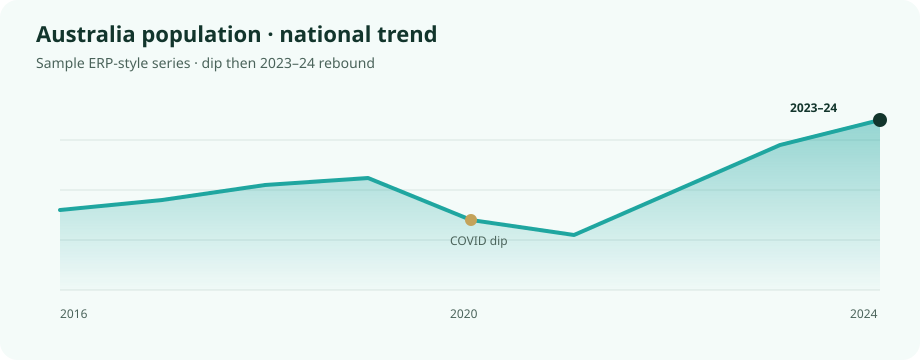
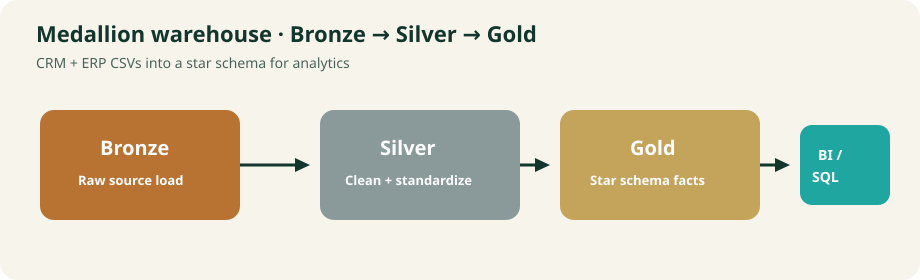
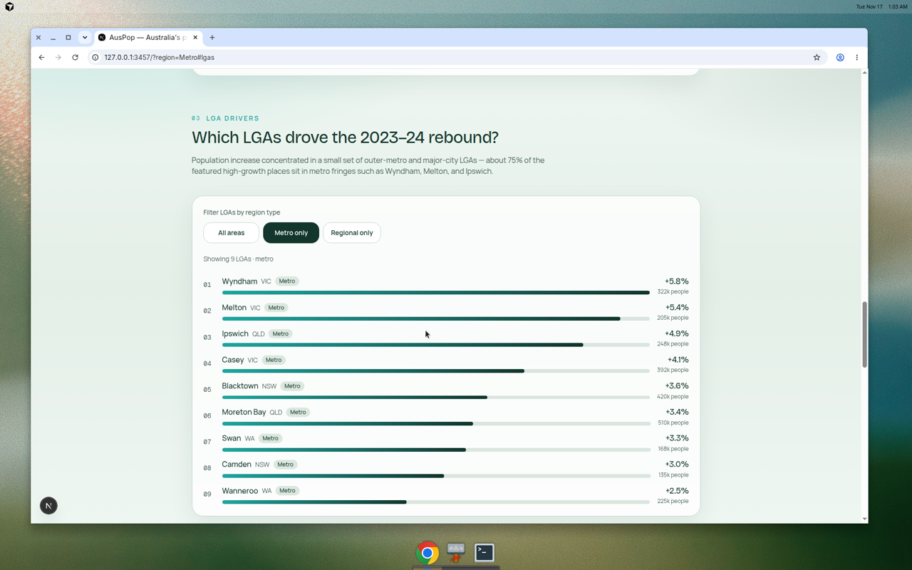

# Ashutosh Bhosale
### Data Engineer · Analyst · Storyteller with numbers

Sydney, Australia · Open to roles nationwide

---

## The short version

I like taking messy source data and turning it into something a human can trust:
warehouses, models, dashboards, and clear stories.

Right now I’m building a portfolio that shows both sides of the craft —
**engineering** (SQL / ETL / medallion) and **storytelling** (Tableau + interactive web).

---

## Charts & diagrams

  

  

<table>
<tr>
<td width="50%" valign="top" align="center">

**AusPop · LGA growth (Metro)**  

</td>
<td width="50%" valign="top" align="center">

**SQL Warehouse · architecture**  

</td>
</tr>
<tr>
<td width="50%" valign="top" align="center">

**Star schema model**  

</td>
<td width="50%" valign="top" align="center">

**Data flow**  

</td>
</tr>
</table>

---

## Featured builds

<table>
<tr>
<td width="50%" valign="top">

### AusPop
**Where Australia’s post-COVID growth landed**

Interactive web companion + Tableau Public analysis of the 2023–24 rebound.

- National trend → states → LGAs
- Metro vs regional filters
- Live app + embedded workbook

[Open live site](https://auspop.apps.grok.bot) · [Code](https://github.com/Ashb8/auspop) · [Tableau](https://public.tableau.com/views/AustraliasPopulationGrowthAfterCOVIDWherethe202324ReboundLanded/AustraliasPopulationReboundAfterCOVIDWhereGrowthLanded202324?:language=en-US&:sid=&:redirect=auth&:display_count=n&:origin=viz_share_link)

</td>
<td width="50%" valign="top">

### SQL Data Warehouse
**Bronze → Silver → Gold on SQL Server**

End-to-end warehouse from CRM + ERP CSVs into a star schema.

- Medallion architecture
- Dimensional modelling
- Data catalog + analytics SQL

[Open repo](https://github.com/Ashb8/Data-Warehouse-SQL-Project)

</td>
</tr>
</table>

---

## Toolbox

  

  
  
  
  
  
  
  
  
  

---

## GitHub pulse

  
  
  

  

---

## Currently exploring

- Cleaner medallion pipelines and dimensional models
- Analytics storytelling that hiring managers can click through in 60 seconds
- Teams in Sydney (or remote AU) that care about data quality + clear narrative

---

### Let’s build something useful with data

[LinkedIn](https://www.linkedin.com/in/ashutosh-bhosalee/) · [AusPop](https://auspop.apps.grok.bot) · [Email](mailto:ashutoshbhosale1999@gmail.com)

Profile home powered by <code>Ashb8/Ashb8</code>

